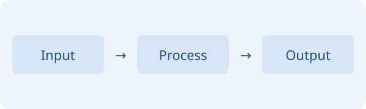

# Obsidian 图片迁移示例

本页使用同目录的 `images/sample.svg`，无需复制其他图片。

## 居中，宽 500 px：位置在前

![[images/sample.svg|C|500]]

## 居中，宽 500 px：大小在前

![[images/sample.svg|500|C]]

## 左对齐，宽 240 px

![[images/sample.svg|L|240]]

## 右对齐，宽 240 px

![[images/sample.svg|240|R]]

## 省略位置，默认居中

![[images/sample.svg|360]]

## 在 Callout 内使用

> [!example] 迁移图片
> ![[images/sample.svg|C|320]]

## 新图片使用标准 Markdown



## 代码示例保持原样

`![[images/sample.svg|C|500]]`

```markdown
![[images/sample.svg|500|R]]
```
